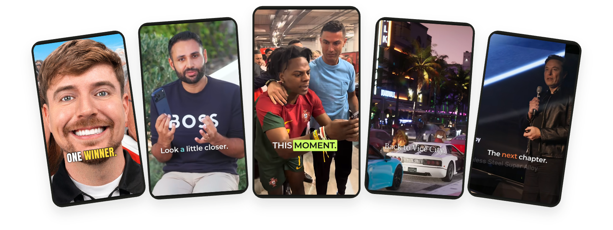
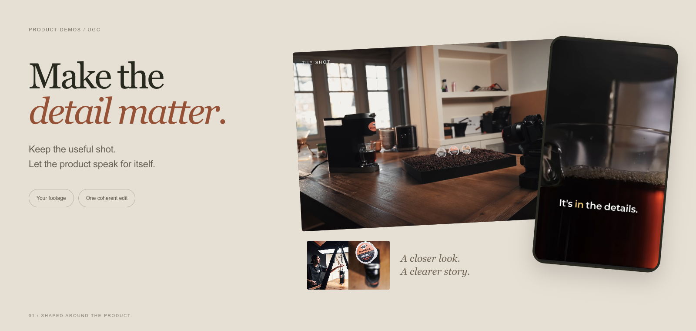
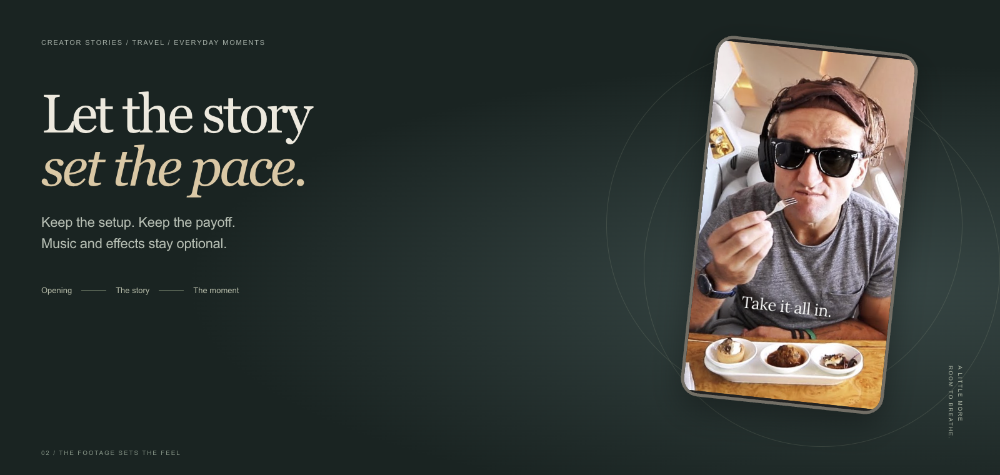
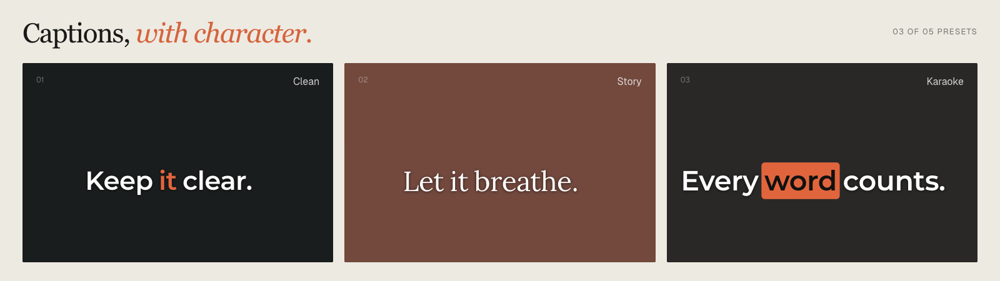
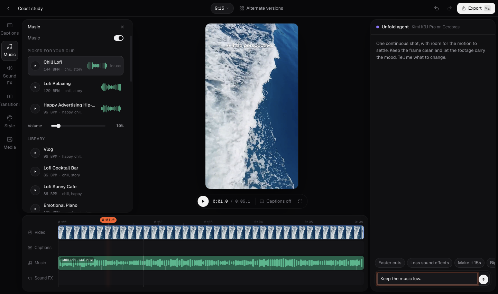
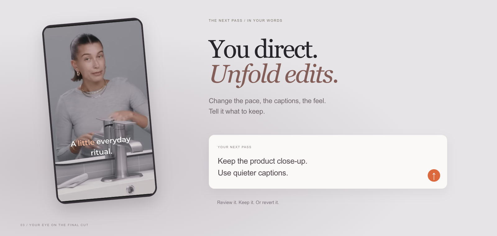

<div align="center">
  <picture>
    <source media="(prefers-color-scheme: dark)" srcset="apps/web/public/brand/logo-on-dark.svg">
    
  </picture>
  <h1>Good footage deserves a good edit.</h1>
  <p>Turn product demos and creator footage into reels you can shape.</p>
  <p><sub>Kimi K3.1 Pro on Cerebras · Standard OpenClaw</sub></p>
</div>

<picture>
  <source media="(max-width: 600px)" srcset="docs/readme/unfold-cover-mobile.png">
  
</picture>

## Why we built Unfold

There is usually a good video hiding in the raw footage.

The useful detail halfway through a product demo. The story that takes a few sentences to find its opening. The moment that works better when you give it a little room.

Finding it means making dozens of small decisions: where to start, what to cut, which words need emphasis, and whether the clip needs music at all. Those decisions shape how the video feels.

**We built Unfold to give creators a first edit to react to—and the control to make it their own.**

Bring your footage and tell it what you have in mind. Unfold builds the first cut. You watch, change the details, ask for another pass, and take the finished video with you.

## Make a reel that fits the footage

### Show the product. Keep the proof.

A demonstration, a detail, a genuine reaction. Build the edit around what your footage actually shows. Add up to four supporting clips, and Unfold can use them as cutaways while the original narration continues.

<picture>
  <source media="(max-width: 600px)" srcset="docs/readme/unfold-product-mobile.png">
  
</picture>

### Let a moment breathe

A personal story, an explanation, a day out. Keep the setup and the payoff together. Use music and effects when they help, and leave space for the creator's voice and natural delivery.

<picture>
  <source media="(max-width: 600px)" srcset="docs/readme/unfold-story-mobile.png">
  
</picture>

### Give the words their own character

Clean and quiet. A little more editorial. A word worth highlighting. Start with a caption style, then tune the typeface, size, colour, position, emphasis and motion for your video.

<picture>
  <source media="(max-width: 600px)" srcset="docs/readme/unfold-type-mobile.png">
  
</picture>

## A first cut. Then your final say.

1. **Upload your footage.** Add a brief, choose your format, and attach any supporting clips you want considered.
2. **Watch the first edit.** Review the opening, pacing, captions and sound in your browser.
3. **Make it yours.** Adjust the controls or describe what you want to change.
4. **Export an MP4.** Choose 720p or 1080p and whether to burn in captions.

A reference video can guide the visual pacing and caption look. Alternate takes are there when you want to explore another opening or direction.

<picture>
  <source media="(max-width: 600px)" srcset="docs/readme/unfold-studio-mobile.png">
  
</picture>
<p><sub>Illustrative editor preview using stock footage and manual controls.</sub></p>

## Talk through the next pass

> Keep the opening. Let the rest breathe. Use quieter captions.

An edit often becomes clearer once you can see it. Ask for a different opening, tighter pacing or a calmer treatment. Review the revision, keep what works, or revert it.

You can also change captions, music, volume, sound effects, transitions, zooms, hook text and aspect ratio directly. Save the edit, undo a change, or return to the saved version.

<picture>
  <source media="(max-width: 600px)" srcset="docs/readme/unfold-remix-mobile.png">
  
</picture>

## What Unfold brings together

- **A first edit shaped by the footage:** opening, source selection, pacing and optional supporting cutaways.
- **Captions you can make your own:** five presets with individual design controls and word timings that follow the cut.
- **Sound and effects with a purpose:** library music, sound effects, transitions and zooms, each optional.
- **A preview you can work with:** playback, timeline, manual controls, chat revisions and alternate takes.
- **An export that includes your choices:** H.264 MP4, 720p or 1080p, optional caption burn-in, and portrait, square or landscape formats.

## Where the agent fits

Kimi K3.1 Pro on Cerebras runs through OpenClaw to make the editorial plan. It receives your brief alongside the transcript, scene information, sampled frames and available assets, then chooses how to put the edit together.

The app turns those choices into a timeline. You can inspect the result, change it, and render the same composition you preview.

```text
Your footage + brief
        ↓
Local media analysis → OpenClaw editing plan
        ↓
Browser preview → Your changes → MP4
```

<details>
<summary>Built with</summary>

| Part | What it does |
| --- | --- |
| Next.js, React and TypeScript | Web app, editor and API |
| Local media pipeline | Video preparation, speech timings, scenes and sampled frames |
| OpenClaw with Kimi on Cerebras | Editorial planning and chat revisions |
| Remotion | Shared browser composition and MP4 rendering |
| Local project storage and SQLite jobs | Saved edits, private media and background-render state |

Source is organised into [`apps/web`](apps/web/), [`packages/agent`](packages/agent/), [`packages/core`](packages/core/), [`packages/video`](packages/video/) and [`services/media`](services/media/README.md).

</details>

## Run locally

You will need the media tools and speech model, your audio-library files, and an OpenClaw gateway with access to the configured Kimi model. The repository includes the code, manifests and small demo assets.

<details>
<summary>Complete local setup</summary>

### 1. Install the workspace

This local setup uses **Node 26.8.2**, **pnpm 12.14.0** and **OpenClaw 2026.11.6**. The media setup script uses Homebrew on macOS. On another platform, provision the equivalent tools before starting.

```bash
pnpm install --frozen-lockfile
cp .env.example apps/web/.env.local
```

Run commands from the repository root unless a step says otherwise. The web app reads `apps/web/.env.local`; a root `.env` alone does not configure it.

### 2. Supply the local media dependencies

A fresh clone includes the code, audio manifests and small demo fixtures. It does **not** include the English speech model, full music/SFX library, local asset-source lists, credentials or user footage.

For transcription, either place a compatible English base GGML model at `services/media/models/ggml-base.en.bin`, or set a valid `STT_MODEL_URL` in the gitignored `services/media/library/sources.local.env`. Obtain that URL from your model source; no download URL is committed.

```bash
bash services/media/scripts/setup.sh
```

The script installs `ffmpeg`/`ffprobe`, `yt-dlp`, `whisper-cpp` and `uv`, downloads the model if needed, and creates a Python 3.12 environment for audio-library analysis. Homebrew must already be installed. Runtime tool/model overrides are documented in [`services/media/README.md`](services/media/README.md).

Restore the audio files that match the committed manifests to:

```text
apps/web/public/assets/music/<id>.mp3
apps/web/public/assets/sfx/<id>.mp3
```

The manifests describe 32 music tracks and 34 sounds; they do not download those files or prove they are present. You will need the matching licensed assets from the project maintainer, or your own appropriately licensed assets and matching manifests. Local source lists and licence records are intentionally excluded from Git. Library rebuild commands require those local lists; see the media-service documentation.

The default pipeline uses the English model configured by `UNFOLD_STT_MODEL`. Media with audio needs a working local speech tool and model. Populate the audio files as well as their manifests so the tracks you select can play and render.

### 3. Configure the OpenClaw profile

Install standard OpenClaw and configure an isolated `unfold` profile. You need Cerebras access to the configured Kimi model; the hackathon trial model is access-controlled. An API key alone does not guarantee model access. See the [official event information](https://luma.com/cerebras-kimi-hackathon).

The profile needs:

| Setting | Value |
| --- | --- |
| Agent ID | `unfold` |
| Agent workspace | Absolute path to this checkout's `agent-workspace` directory |
| Model | `cerebras/moonshotai-kimi-k3.1-pro-trial` |
| Provider base URL | `https://api.cerebras.ai/v1` |
| Gateway | Loopback, port `18890`, token authentication |
| HTTP endpoint | Standard `/v1/chat/completions` enabled |

<details>
<summary>Profile configuration example</summary>

For OpenClaw 2026.11.6, create `~/.openclaw-unfold/openclaw.json` with the following configuration. Replace the workspace path with your checkout's absolute path. For an existing profile, merge the relevant settings with your configuration.

```json
{
  "models": {
    "mode": "merge",
    "providers": {
      "cerebras": {
        "baseUrl": "https://api.cerebras.ai/v1",
        "apiKey": "${CEREBRAS_API_KEY}",
        "api": "openai-completions",
        "models": [
          {
            "id": "moonshotai-kimi-k3.1-pro-trial",
            "name": "Kimi K3.1 Pro",
            "reasoning": true,
            "input": ["text", "image"],
            "contextWindow": 131072,
            "maxTokens": 32768
          }
        ]
      }
    }
  },
  "agents": {
    "defaults": {
      "model": { "primary": "cerebras/moonshotai-kimi-k3.1-pro-trial" }
    },
    "entries": {
      "unfold": {
        "workspace": "/absolute/path/to/unfold/agent-workspace",
        "model": "cerebras/moonshotai-kimi-k3.1-pro-trial",
        "thinkingDefault": "low",
        "tools": {
          "profile": "minimal",
          "deny": ["group:runtime", "group:fs", "group:ui", "group:web"]
        }
      }
    }
  },
  "gateway": {
    "port": 18890,
    "mode": "local",
    "bind": "loopback",
    "auth": { "mode": "token", "token": "${OPENCLAW_GATEWAY_TOKEN}" },
    "http": { "endpoints": { "chatCompletions": { "enabled": true } } }
  }
}
```

Put `CEREBRAS_API_KEY` and `OPENCLAW_GATEWAY_TOKEN` in `~/.openclaw-unfold/.env`. Generate your own gateway token, for example with `openssl rand -hex 32`, and use the same token in the app configuration below. Keep these values private.

</details>

Validate the profile and start the gateway in a separate terminal:

```bash
openclaw --profile unfold config validate
openclaw --profile unfold gateway run --port 18890
```

More profile context is in [`agent-workspace/README.md`](agent-workspace/README.md).

### 4. Configure and start the app

In `apps/web/.env.local`, set:

```dotenv
UNFOLD_DEV_NO_AUTH=1
OPENCLAW_GATEWAY_URL=http://127.0.0.1:18890
OPENCLAW_GATEWAY_TOKEN=your-gateway-token
OPENCLAW_AGENT_ID=unfold
```

Delete the copied empty `UNFOLD_DATA_DIR=` assignment to use the default `<repo>/data`, or set it to an absolute writable directory. Leave the optional auth-provider fields empty for local demo mode. The gateway reads its own Cerebras credentials; setting a key only in the web app does not configure the gateway.

```bash
pnpm dev
```

Open the local URL printed by Next.js, normally [http://localhost:3000](http://localhost:3000), then go to `/app`. Network access is needed for agent requests and the caption fonts used by preview and rendering.

This quickstart uses local demo mode and its configured gateway. The bypass is disabled in production. Optional account and encrypted-key setup is documented in [`db/README.md`](db/README.md); hosted email and real saved-key generation still need end-to-end validation.

For optional background rendering, provision the browser and Bun, then configure the API and worker to share private media storage and one absolute SQLite path on a persistent host. Worker setup is in [`infra/jobs-runtime.md`](infra/jobs-runtime.md) and [`infra/jobs.env.example`](infra/jobs.env.example). Existing local-media migration details are in [`db/migrations/20261122_private_storage.md`](db/migrations/20261122_private_storage.md).

<details>
<summary>Explore the interface with fixtures</summary>

Set `NEXT_PUBLIC_UNFOLD_API=mock` alongside `UNFOLD_DEV_NO_AUTH=1` in `apps/web/.env.local`, then restart the development server. This mode uses sample plans and simulated timings. Upload analysis and generation are mocked, and its export action returns the source video rather than rendering the edited composition.

Remove `NEXT_PUBLIC_UNFOLD_API=mock` and restart to use the live pipeline.

</details>

</details>


<details>
<summary>Development commands</summary>

```bash
pnpm typecheck
pnpm build
```

</details>

## Built for the hackathon

Unfold was built for the [Cerebras × Kimi K3.1 Pro hackathon](https://luma.com/cerebras-kimi-hackathon), with the editing agent at the centre of the product. Event and submission details are kept in [`notes/HACKATHON.md`](notes/HACKATHON.md).

## The creator

**Maaz** · [GitHub](https://github.com/somewherelostt) · [X / @maaztwts](https://x.com/maaztwts)

<details>
<summary>About the images</summary>

The reel previews and promotional panels are design examples composed with Unfold’s caption renderer, third-party stills and illustrative sample text. They show portrait layouts, typography and draft editing directions. Creator names identify the source material only; no endorsement is implied.

The editor preview uses [coastal footage](https://www.pexels.com/video/dynamic-ocean-waves-captured-from-above-29285421/) and manual controls. Caption specimens use illustrative sample text. Neither is a live generation benchmark.

</details>
